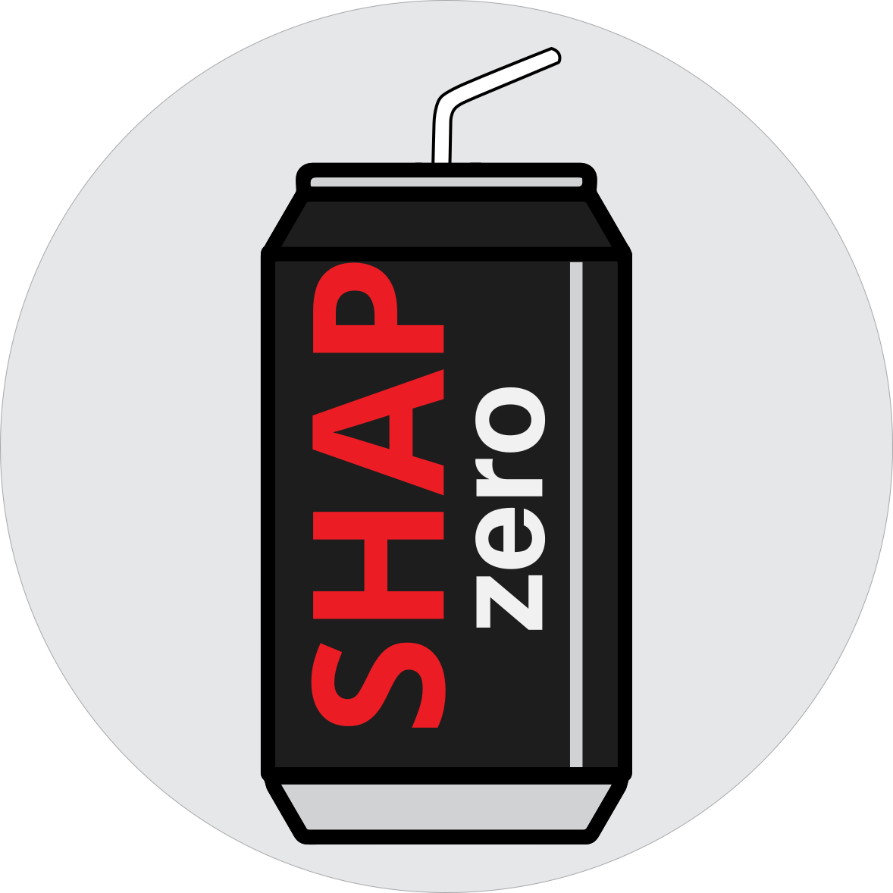

# SHAP zero Explains Biological Sequence Models with Near-zero Marginal Cost for Future Queries 

## Disclaimer 

If you plan on using SHAP zero to explain your own biological sequence models, please use our `shapzero` **Python package implementation** found at [https://github.com/amirgroup-codes/shap-zero](https://github.com/amirgroup-codes/shap-zero). This repository contains code to reproduce our NeurIPS 2025 paper, which you can find a preprint of [here](https://arxiv.org/pdf/2410.19236).

SHAP zero is an amortized inference method for approximating SHAP values and Shapley interactions in biological sequence models. This repository contains code to reproduce experiments from the article "SHAP zero Explains Biological Sequence Models with Near-zero Marginal Cost for Future Queries" by Darin Tsui, Aryan Musharaf, Yigit Efe Erginbas, Justin Singh Kang, and Amirali Aghazadeh. 

## Quickstart

A full tutorial on how to reproduce experiments here has been left in the **TIGER/** folder, which **inDelphi/** and **Tranception/** follow closely. We recommend you start from the TIGER folder first. We additionally note that inDelphi, being an older model, was implemented on Python 3.5.6. We had to adapt SHAP-IQ and FastSHAP to work on this older version, which we have made clear where applicable both in the coding implementation and in the Appendix of our paper.  

## Description of folders

**TIGER/:** folder to reproduce TIGER experiments. A full tutorial has been left in the folder. 

**inDelphi/:** folder to reproduce inDelphi experiments. The file structure is identical to TIGER's. 

**Tranception/:** folder to reproduce Tranception experiments. The file structure is identical to TIGER's.

**supp/:** folder containing supplemental materials provided in the Appendix.

**gen/:** general purpose functions. 

**qsft/:** functions needed to run the sparse Fourier algorithm *q*-SFT.
